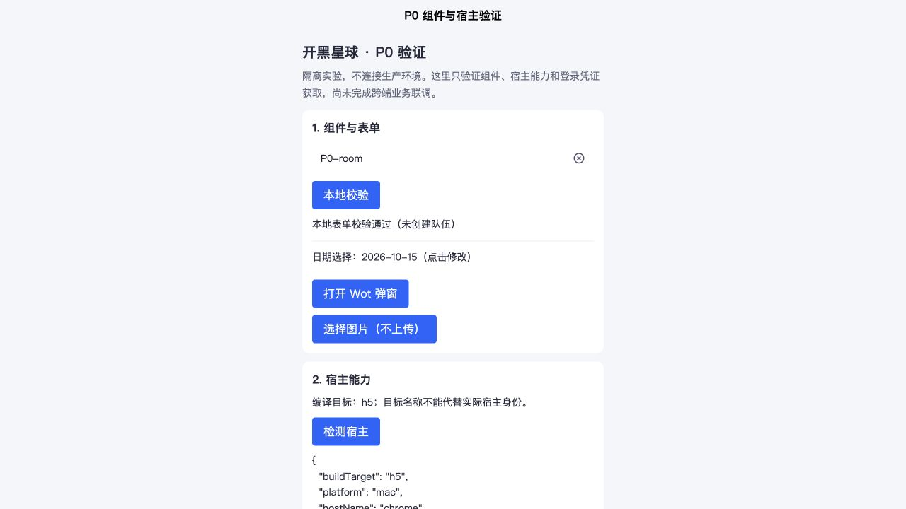

# P0：多平台接入验证记录

日期：2026-10-15（Asia/Shanghai）
分支：`codex/uniapp-multiplatform-plan`
基线：本地 main `6deac7adec01719626ca7da8a66be5af38b275b8`

## 1. 当前结论

P0 已开始，尚未达到完整退出条件。已完成本地业务基线检查、公开官方资料核查、隔离 uni-app 组件/宿主诊断原型；后续已打通独立探测函数的真实公网 HTTP 链路和 H5 调用。真实平台登录、业务数据访问和跨端上车仍待身份与隔离测试资源接入；本文件不将编译或探测通过计作真实多端业务联调完成。

当前推荐仍是：普通版 uni-app + Vue 3 + TypeScript；腾讯云后端优先复用。后续已从用户截图和其明确指定的 CloudBase 控制台确认当前环境有已开启的 HTTP 网关，支持关联现有 team 云函数；尚未创建或实测 HTTP 业务入口，不迁生产数据。Wot UI 是已进入编译验证的候选，不是已全平台验收的最终结论。完整 unibest 工程搭建属于 P1；P0 使用更小的官方模板基础组合减少变量。

## 2. 已执行与证据

| 项目 | 结果 | 证据/边界 |
| --- | --- | --- |
| Git 基线 | 当前分支基于本地 main | 未 fetch、未修改 main、未提交/推送 |
| 已有修改保护 | mine.js/mine.wxml 原样保留 | 与规划开始时 SHA-1 一致 |
| 原业务基线 | 107 项 node 测试全部通过 | `node --test tests/*.test.js`；不等价于云端集成测试 |
| 隔离原型 | 已创建 | `experiments/p0-uniapp/`，不初始化 wx.cloud、不写生产数据 |
| 依赖安装 | 完成并生成 package-lock.json | 固定官方模板基础编译链和 Wot UI 版本 |
| QQ 官方公开文档 | 已直接阅读 | 入驻页、框架页、FAQ；未登录应用后台 |
| 微信云开发控制台 | 未能读取 | 浏览器站点安全策略阻止观察 cloud.weixin.qq.com；没有换入口或接口绕过 |
| 用户指定的腾讯云控制台 | 已直接读取 | 用户在后续明确提供并授权操作 tcb.cloud.tencent.com 的当前环境 HTTP 网关页面；该站点访问检查通过 |
| 腾讯云 HTTP 能力 | 已通过真实公网和 H5 调用验证 | 仅 /p0/health → p0Health；详见第 10 节 |
| 云端部署与数据迁移 | 已创建独立 p0Health 并保存其路由，尚未迁移数据 | 未改 team 入口、数据库或套餐；详见第 9、10 节 |

原有修改校验值：

```text
374ce4c704dd942aedd80d456cf77f78af1d8c46  miniprogram/pages/mine/mine.js
740af59d57d17da177f5c94b97e9931c05d17df1  miniprogram/pages/mine/mine.wxml
```

## 3. QQ 接入调查

### 3.1 能确认的事实

1. [QQ 当前入驻文档](https://q.qq.com/wiki/)仍列出小程序能力和创建流程；该页材料表包含个人、企业/个体户主体。
2. [独立 QQ 小程序框架文档](https://q.qq.com/wiki/develop/miniprogram/frame/)描述 QML/QSS、QQ API 和独立运行环境。
3. [小程序 FAQ](https://q.qq.com/wiki/FAQ/devlop/)保留微信工程兼容写法、独立 QQ AppID 和不同登录态的说明。
4. 上述 FAQ 与入驻页对个体户入驻的描述存在冲突，说明存量资料不能替代当前后台验证。该差异不代表用户的主体类型已经确认。

这些资料证明存在独立 QQ 路线的文档，不能证明本应用可创建新 QQ 应用，也不能证明截图里的微信 AppID 已获准在 QQ 宿主运行。没有取得本 AppID 的官方拒绝原因；不将“使用 wx.cloud”或“没有 QQ 插件”直接定为根因。

### 3.2 两种路线的下一步

| 路线 | 当前证据 | 下一步 | 禁止混淆的结论 |
| --- | --- | --- | --- |
| QQ 内运行微信小程序 | 用户截图显示该应用当前不支持 | 在本应用后台/当前官方接入说明中核实准入、宿主登录和不兼容能力 | mp-qq 编译通过不能证明此路线通过 |
| 独立 QQ 小程序 | 官方存量文档存在、原型可生成对应编译目标 | 确认账号是否可创建/发布、测试 AppID、类目、QQ 工具与真机登录 | 微信 AppID 不能直接冒充 QQ AppID；登录态不同 |

当前不自动创建账号、不接受平台协议、不替换生产 project.config.json 的 AppID。不使用未经官方确认的插件 ID、provider 或登录参数。

## 4. 云后端可复用性调查

### 4.1 当前代码证据

| 依赖点 | 位置 | 对多端接入的影响 |
| --- | --- | --- |
| wx.cloud 初始化 | miniprogram/app.js | 外部宿主不默认具备微信云链路 |
| 集中云函数调用 | miniprogram/utils/cloud.js | 可在这里替换传输层，业务页面无需各自实现请求 |
| 微信身份 | cloudfunctions/team/index.js：getOpenid | HTTP 调用没有可信微信上下文，需要后端验证登录凭证 |
| 用户/车头/成员/角色 | getUser、isTeamHost、adminGuard 等 | 统一内部 userId 前不能直接用外部平台标识替代 OpenID |
| 文件上传 | miniprogram/components/profile-gate/index.js | wx.cloud.uploadFile 需上传服务适配；本地选图不等于可上传 |
| 微信检测和订阅消息 | cloudfunctions/team/index.js、config.json | 非微信来源需独立能力评估，不能复用伪造 OpenID |
| getTeam 修复数据 | getTeam → dedupeTeamMembers | 看似读取详情的动作也可能修复/写入，P0 不能对生产队伍随意调用 |
| Timer 分支 | team 云函数入口 | HTTP 入口不能直接信任客户端的 Type/TriggerName 字段 |

当前密码规则也已核对：未授权用户返回空 roomPwd 和 hasPwd；车头可见，成员在队伍未取消时可见。到期状态与取消状态不同。迁移验收按此实际规则设计，不擅自扩大可见范围。

### 4.2 官方能力与项目事实分开

[CloudBase HTTP 网关文档](https://docs.cloudbase.net/service/access-cloud-function)说明云函数可通过标准 HTTP 调用。后续已在用户指定的 CloudBase 控制台中验证：当前 cloud1 环境 HTTP 网关已开启，关联资源支持云函数，实例列表存在 team。此证据支持继续验证路线 A，但不代表现有函数已经具有 HTTP 事件适配、业务鉴权和多端登录能力。

[腾讯云环境 FAQ](https://cloud.tencent.com/document/product/876/18438)描述了微信开发者工具环境与独立 QQ 云开发资源的限制。因此不能直接将当前 wx.cloud 环境 ID 填进独立 QQ SDK 作为统一后端。此限制也不能直接解释 QQ 宿主兼容微信应用的截图。

当前机器没有可直接调用的 tcb/cloudbase CLI；本会话没有可用 CloudBase 连接器。最初的 cloud.weixin.qq.com 页面被拦截后未尝试绕过。用户随后自行提供截图、明确指定 tcb.cloud.tencent.com 并授权操作；对该站点的访问检查通过，已直接完成下述只读检查。

已确认的环境状态：

- 环境名 cloud1，个人版，上海地域，控制台显示生效中，到期时间为 2027-04-04 23:59:59。
- 用户提供的套餐截图显示 ¥19.9/月；本轮没有修改套餐、续费或按量开关。
- HTTP 网关与默认域名均处于开启状态；首次检查时自定义域名和路由列表为空，后续探测路由状态见第 10 节。
- 默认域名页明确提示仅限开发测试，存在频率、功能和稳定性限制；正式发布需规划自定义域名，不把默认域名作为生产保障。
- 新增路由窗口包含云函数、云托管、云存储、静态网站托管、自定义应用等资源类型；首次检查实例列表只有 team，后续另建了 p0Health。
- 新增路由窗口的身份认证默认未开启。仅检查选项，未选择 team 保存路由，也未更改开关。
- 当前账号的环境切换列表只显示 cloud1；这不能证明其他账号不存在测试环境，但本次可见范围内没有第二环境。
- 首次只读检查后关闭了配置窗口，当时没有新增公网入口；用户后续确认并执行的路由操作见第 10 节。

证据：[资源类型与 team 列表截图](p0-evidence/gateway-function-options.png)、[网关状态截图](p0-evidence/gateway-current-state.png)。

### 4.3 需要人工核对的最小信息

仅记录状态，不发送 AppSecret、私钥、token 或个人身份材料：

- 已核实：cloud1 个人版、HTTP 网关已开启、默认域名已开启、自定义域名和路由为空。
- 仍需确定测试资源方案：当前可见环境只有 cloud1，不拿生产大厅试上车。
- 仍需准备正式 HTTPS API 自定义域名，并核对各平台域名配置要求。
- QQ 已有账号/测试应用情况，以及本 AppID 是否有微信小程序 QQ 接入入口或具体不支持原因。

### 4.4 取得环境后执行的真实原型

1. 确认测试环境，准备两个测试用户和专用测试队伍，记录原始状态。
2. 平台 code 在后端向平台核验，返回内部用户会话；不接受客户端自报 userId。
3. 使用同一测试后端读取大厅与详情，验证图片 HTTPS 地址可被另一端访问。
4. 第二端真实加入，微信端刷新确认人数/成员一致；重复加入不重复占位。
5. 以未加入、成员、车头三类身份核对 roomPwd、修改、取消权限；再测试满员、封禁和会话过期。
6. 在每个平台留下响应摘要和真机操作记录，不记录登录 code、完整令牌或房间密码。

未执行该流程前，不在 P0 或计划书中勾选“真实跨端闭环通过”。

## 5. 原型与构建验证

原型目录：`experiments/p0-uniapp/`。使用 DCloud 官方 vite-ts 模板的编译器系列 `3.0.0-5020420260813003`，Vue 3.4.21、Vite 5.2.8、TypeScript 5.6.3、Wot UI 2.3.2、Sass 1.98.0。固定版本是本轮可复现的验证组合，不宣称它是所有依赖的最新版本。

首次安装发现 @dcloudio/types 3.4.8 与编译器 peer dependency 3.4.31 不一致，已对齐为 3.4.31，没有用 force/legacy-peer-deps 跳过约束。使用 `--ignore-scripts` 安装；没有修改全局 npm、Node 或包管理器。

原型显式关闭 uniStatistics；登录诊断不输出或持久化 code；图片只本地预览，不上传任何服务。

构建执行方式：

```sh
cd experiments/p0-uniapp
npm ci
npm run check:matrix
```

结果与每个 job 日志位于 `dist/p0/`；dist 不入库。最终构建/H5 结果见本文末尾执行结果补充。组件通过编译仍需 AppID、开发工具、iOS/Android 真机验证；原生日期选择和本地选图也需要真实设备测试。

本轮不锁定长期 UI 选择：Wot UI 当前官方支持说明主要列微信、支付宝、钉钉、H5、App；QQ/抖音须按具体组件验证。锁定文件中的旧依赖维护提示与 Sass legacy API 警告一并记录，P1 选型时评估升级，不把无错误构建当作长期依赖审计。

## 6. 平台与成本核查台账

| 平台 | 编译目标/路线 | 账号与准入 | 真实登录/业务闭环 | 发布自动化 |
| --- | --- | --- | --- | --- |
| 微信 | mp-weixin | 现有源码有 AppID，后台状态未核对 | 现有应用另行验收；新原型待测 | miniprogram-ci，凭据未配置 |
| QQ 兼容宿主 | 可能复用微信产物，须确认 | 当前截图不支持，原因待查 | 未通过 | 随接入路线确认 |
| 独立 QQ | mp-qq | 用户明确表示目前仅注册微信，暂无已知 QQ 账号/AppID | 未通过 | 待账号条件具备后再接入 |
| 支付宝 | mp-alipay | 未核实 | 未通过 | 官方工具/uni-mini-ci 候选 |
| 抖音 | mp-toutiao | 未核实 | 未通过 | 官方 CLI/接口候选 |
| 百度/快手/小红书/京东 | 待选目标 | 未核实 | 未执行 | 按选定平台核对 |
| 飞书/钉钉/淘宝等 | 按场景推进 | 未核实 | 未执行 | 按选定平台核对 |

费用未取得套餐与用量信息，不能给出已确认单价。需补齐计算、数据库读写、对象存储/出网、网关、域名、内容检测、可选短信和 CI；测试环境与生产分别计算。P0 没有开通付费服务。

## 7. 退出条件和下一步

- [x] 本地原业务测试基线建立，保护已有修改。
- [x] QQ 两条路线、微信云身份依赖和主要迁移点有文档证据。
- [x] 隔离组件/宿主验证原型与可重跑构建脚本。
- [ ] 本 AppID 的 QQ 路线确认及实际进入成功。
- [ ] 测试云环境能力、域名、套餐费用明确。
- [ ] 至少微信与第二可接入端完成真实登录、同大厅、详情、上车及权限验证。
- [ ] 目标端关键组件真机通过，形成 P1 版本选择。

当前不进入全量页面迁移。先补后台状态和测试应用信息，完成第 4.4 节后，再按主计划推进 P1/P2。

## 8. 本轮最终执行结果

| 检查 | 结果 | 范围 |
| --- | --- | --- |
| typecheck | 通过 | vue-tsc，无类型错误 |
| build:h5 | 通过 | Web 产物生成 |
| build:weixin | 通过 | 微信目标产物生成 |
| build:qq | 通过 | 独立 QQ 目标产物生成，未验证宿主准入 |
| build:alipay | 通过 | 支付宝目标产物生成 |
| build:toutiao | 通过 | 抖音目标产物生成 |
| H5 空值校验 | 通过 | 点击后显示“请填写房间 / 加入方式” |
| H5 有效输入 | 通过 | 输入后显示本地校验通过；不创建队伍 |
| H5 弹窗 | 通过 | 打开、输入共享、完成后关闭并保留输入 |
| H5 宿主诊断 | 通过 | 显示 buildTarget=h5、宿主浏览器信息 |
| H5 登录边界 | 通过 | 明确提示使用真实小程序 AppID，不伪造登录 |
| 真机日期/图片/安全区 | 待验证 | 不能由 H5 桌面交互替代 |
| 真实后端与跨端上车 | 未执行 | 缺经确认的测试环境和平台应用条件 |

可复现构建信息：[build-results.json](p0-evidence/build-results.json)。H5 预览在本轮运行于本机 127.0.0.1:5187；重新打开需运行原型 README 中的 dev 命令。页面截图如下，仅作为 Web 交互证据：



## 9. 独立 HTTP 探测后续推进

用户明确目前只注册微信、暂无已知 QQ 开放平台账号/AppID，并授权继续推进 HTTP 验证，因此先推进平台无关的传输探测，不将 QQ 账号准备作为本地工作前提。

- 新增 `cloudfunctions/p0Health/`：无依赖、无云 SDK、无数据访问，只返回固定状态标识；写方法、业务 action、定时事件被拒绝，不回显参数、头或身份。
- 新增四项行为测试，加上原业务共 111 项测试全部通过。前端类型检查和 H5/微信/独立 QQ/支付宝/抖音五端编译再次全部通过；原有 mine 两处修改校验值未变。
- 前端增加独立 HTTP 探测按钮；只有显式配置 VITE_P0_HEALTH_URL 后可调用，未配置时禁用。探测成功也明确不等于登录/数据库/组队业务通过。
- 代码包上传受到扩展本地文件访问权限限制，未要求扩大权限；改用控制台在线模板编辑，完整替换入口和无依赖 package.json，回读对比一致后创建。
- 已在现有 cloud1 创建普通云函数 `p0Health`（`lam-fyqfg2iv`），控制台状态“正常”。Node.js 20.19、128 MB、执行超时 3 秒；API Key 注入未启用，不改变现有 team。
- 创建前源码与包配置的 SHA-256 分别为 `532e836075730bc0e6c7e286b9992b2e4fe5f77e0b07f25a31fe4ea8f67db4c1`、`460fad6ba0198d80977ac4a30af909d2ba415603d117ac8746af7041fd3f0ddc`。
- 测试编辑器首次加载失败，重试后恢复。已执行两次真实云函数调用：GET 事件返回 200 与固定状态体（requestId: 048b0fb0-c8a6-11f1-ba00-5254002608d6），POST 返回 405/METHOD_NOT_ALLOWED（requestId: 13fcf378-c8a6-11f1-8ced-525400c6cd80）。这是控制台函数测试，不等于网关 HTTP 链路已通过。
- 尚未新增 `/p0/health` 公网路由。公开入口保存前需单独确认其访问范围。

拟验证范围仅为默认测试域名上的 `/p0/health` → p0Health，不包含用户登录、数据库、team、全局跨域修改或套餐升级。真实业务联调仍需测试数据隔离及各端身份接入。

云端调用证据：[GET 固定状态响应](p0-evidence/p0-health-cloud-get.png)、[POST 被拒绝](p0-evidence/p0-health-cloud-post.png)。

上一轮停留在保存前：默认测试域名、`/p0/health`、云函数 `p0Health`、路由启用、网关跨域规则不应用到此路由、路径透传关闭、身份认证关闭。[当时待确认配置截图](p0-evidence/p0-health-route-pending.png)。用户后续已确认继续，最终状态见第 10 节。

## 10. 公网传输验证与身份基础模块

### 10.1 已生效的探测路由

用户确认继续后重新读取控制台，发现路由已经存在，且认证、跨域和路径透传均开启；先发起无凭据 GET，得到 401/MISSING_CREDENTIALS。没有重复创建路由。随后按已确认的匿名只读探测方案，仅编辑这一条路由，将三项设置关闭并保存；资源保持 p0Health。

地址：`https://cloud1-d9gniyjzh4e2ffb1c-1312971366.ap-shanghai.app.tcloudbase.com/p0/health`。

| 实际公网验证 | 结果 |
| --- | --- |
| GET 固定标识 | 200，精确匹配 ok/service/version |
| HEAD | 200，无响应体 |
| POST | 405，METHOD_NOT_ALLOWED |
| 本地来源跨域 GET | 200，只返回 http://127.0.0.1:5187 的允许来源，无凭据许可 |
| 本地读方法 OPTIONS | 204，空体和匹配的允许来源 |
| 未知子路径 | 404，NOT_FOUND |
| H5 页面真实调用 | 显示“HTTP 探测通过；尚未验证用户登录、数据库或跨端上车” |

可重跑脚本 `experiments/p0-uniapp/scripts/check-http.mjs`；机器可读结果：[http-results.json](p0-evidence/http-results.json)。本机 .env.local 已配置该 URL，文件被 git 忽略。当前控制台限频能力标注标准版/企业版，未升级套餐或修改全局限频；默认测试域名与现有环境配额的限制仍适用。

证据：[路由生效](p0-evidence/p0-health-route-enabled.png)、[H5 真实调用](p0-evidence/p0-health-h5-live.png)。

### 10.2 身份底层实现边界

新增 `cloudfunctions/team/lib/identity.js` 和六项身份边界测试。身份键隔离 provider/appId/subject；微信 resolver 只读取注入的可信 SDK 上下文，校验应用，再查已有身份映射。缺失映射、字段冲突、数据库失败均拒绝；不接受请求传入的 OpenID，不继承映射中的管理员字段，不自动回填数据。

该模块尚未接入 team/index.js，尚未部署为登录逻辑，没有创建生产身份集合或签发令牌。具体契约与下一步见 [统一身份接口契约](统一身份接口契约.md)。下一阶段实现持久身份映射和旧微信入口 adapter，再验证真实登录与业务权限；公网健康探测不能替代这部分验收。

最终本地回归：`node --test tests/*.test.js`，117 项全部通过。新增身份模块没有改变现有 team/index.js 或 mine 两处用户修改。
